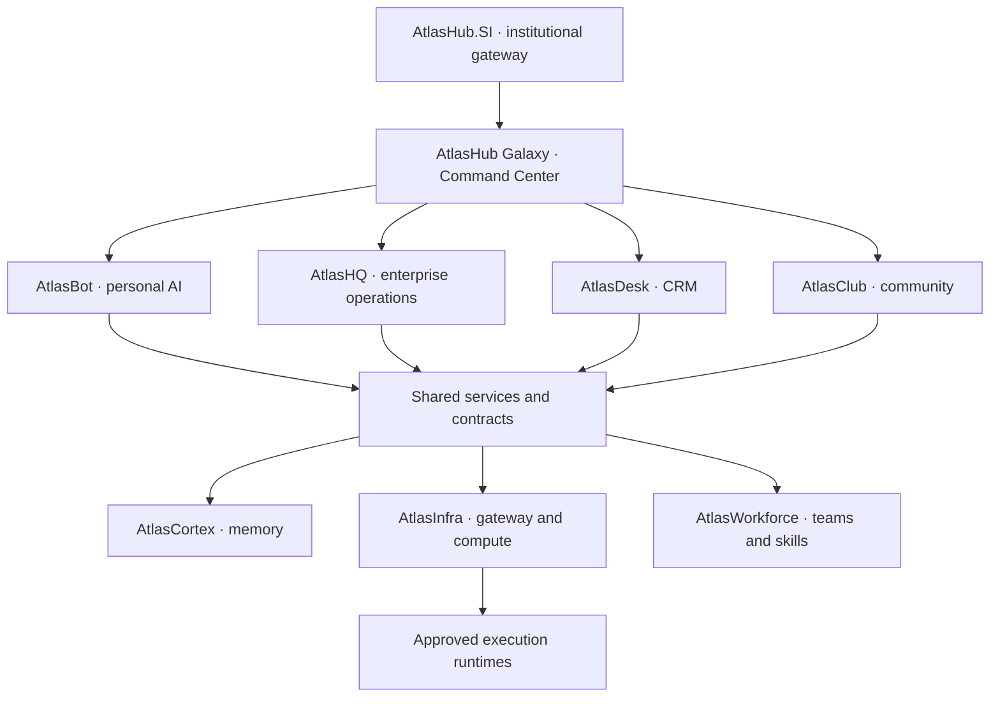

# ATLASHUB · SI

### AUGMENTED ENTERPRISE · UNIFIED INTELLIGENCE

**One intelligence. Multiple worlds. One connected ecosystem.**

**London · United Kingdom  |  Lisbon · Portugal  |  Goiânia · Brazil**

## A global hub for the augmented enterprise

AtlasHub is building an interconnected ecosystem for people, AI agents and AI-native organizations. Our ambition is to make persistent intelligence, practical automation and governed execution accessible — from an individual creating their first digital assistant to an enterprise coordinating a hybrid workforce across multiple businesses.

We bring together open-source foundations, Atlas engineering, independent infrastructure and reusable operational knowledge. We integrate before duplicating, preserve freedom of execution, and design for accountable human authority.

## Explore the Atlas Galaxy

| World | Mission | Direction |
|:--|:--|:--|
| 🤖 **[AtlasBot](https://github.com/AtlasHub-Si/Atlas-Bot)** | Personal and professional AI | Conversational assistants, teams, tools, routines and computers. OpenMausBot is the priority candidate, subject to validation. |
| 🏢 **AtlasHQ** | Enterprise AI operating workspace | Paperclip-based projects, objectives, hybrid workforce, budgets, approvals and governance. |
| 🧠 **AtlasCortex** | Persistent intelligence | Governed knowledge, GBrain, federated memory and provenance. |
| ☁️ **AtlasInfra** | Infrastructure and AI platform | Cloud and local computing, model routing, gateways, identities, cost and reliability. |
| 💼 **[AtlasDesk](https://github.com/AtlasHub-Si/Atlas-Desk)** | Business relationships and operations | CRM, leads, communications and future integrated billing. |
| 🌐 **[AtlasClub](https://github.com/AtlasHub-Si/Atlas-Club)** | Community and learning | Education, practical AI adoption and future team distribution. |
| 🧩 **[AtlasWorkforce](https://github.com/AtlasHub-Si/Atlas-Workforce)** | Reusable intelligence | Agent roles, skills and portable team packages for personal and enterprise use. |
| 🪐 **[AtlasHub Galaxy](https://github.com/AtlasHub-Si/AtlasHub-Command-Center)** | Unified access and context | Corporate ecosystem showcase today; intended role-aware navigation and operational visibility tomorrow. |

Some implementation repositories are access-controlled. Product descriptions communicate direction, not a guarantee of public availability or production readiness.

## One ecosystem, distinct responsibilities

- **One authority per domain:** enterprise work belongs to AtlasHQ; personal conversations to AtlasBot; CRM records to AtlasDesk; governed knowledge to AtlasCortex.
- **Runtime freedom:** approved agents and models can evolve independently of product experiences.
- **Security by design:** scoped access, tenant separation, least privilege, auditability and human approval where required.
- **Evidence before claims:** live, reported, experimental and conceptual capabilities are explicitly distinguished.
- **Open foundations, responsible stewardship:** preserve upstream licenses and notices; build Atlas-owned integrations and experiences without misrepresenting third-party work.

## Technology and developer ecosystem

We build with and study the global cloud, AI and open-source ecosystem, including developer communities and startup resources:

| Ecosystem | Resources |
|:--|:--|
| **Google for Developers & Google Cloud** | [Developer Program](https://developers.google.com/program) · [Google Cloud](https://cloud.google.com/) |
| **NVIDIA** | [Developer Community](https://developer.nvidia.com/community) · [Developer Program](https://developer.nvidia.com/developer-program) |
| **Amazon Web Services** | [AWS for Startups](https://aws.amazon.com/startups/) · [AWS Activate](https://aws.amazon.com/startups/credits/) |
| **Open-source foundations** | [OpenMausBot](https://github.com/milind-soni/OpenMausBot) · [Paperclip](https://github.com/paperclipai/paperclip) · [Paseo](https://github.com/getpaseo/paseo) |

References identify technology ecosystems and relevant programs; they do not imply sponsorship, certification, formal partnership or admission to any program.

## Global presence

**AtlasGlobal Tech LTD · AtlasHub Brasil**  
London, United Kingdom · Lisbon, Portugal · Goiânia, Brazil

Official website and contact channel: **[atlashub.si](https://atlashub.si)** · corporate communications use the `@atlashub.si` domain.

For project-specific licensing and attribution, consult each repository's LICENSE and notices.

---

**BUILD · CONNECT · INNOVATE**

*AtlasHub · Intelligence for the Augmented Enterprise*

